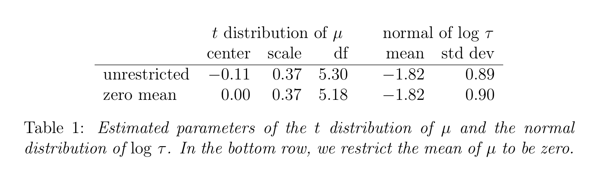
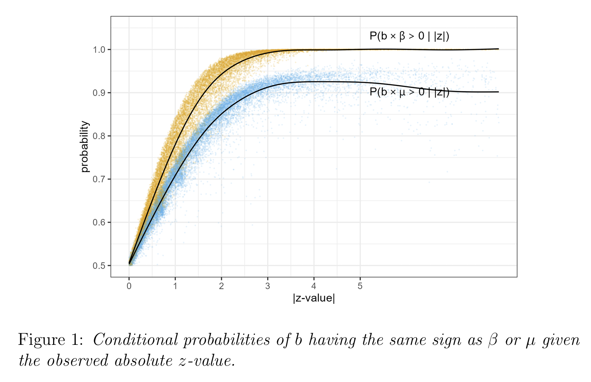
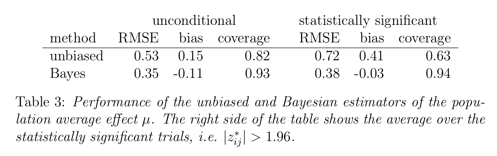

```{r setup, include=FALSE}
knitr::opts_chunk$set(echo = TRUE)
library(baggr)
# library(ggplot2) #for themes, xlim etc.
# baggr::baggr_theme_set(theme_classic(base_size = 20))
# baggr::baggr_theme_update(text = element_text(family = "mono"))
```

Joint work with Erik van Zwet, Andrew Gelman. Available online.

## The Story (funder's perspective)

- I want to fund new effective interventions but I don't want to overcommit funds
- Many interventions that people bring to me are because of selection (winner's curse)
- I can penalise the RCTs with weak evidence
- Bayesian prior is a sensible way to do it
	- Weaker evidence gets penalised more!
	- This has been proposed many times; seems to work well
- But I don't actually care about what happened in RCT, I want to know about future implementation
	- Need to consider external validity / heterogeneity 
	- Worth doing a meta-analysis: estimates average effects + heterogeneity

## Statistician's perspective

- Standard model for a body of research:
    * Study effect: $\beta_j = \mu + u_j$ where $u_j \sim N(0,\tau^2)$
    * Estimate: $b_j = \beta_j + \epsilon_j$ where $\epsilon_j \sim N(0,s_j^2)$
- Consider one study, $j=1$:
    * Can't estimate between-study variation $\tau$
    * Common practice: Ignore it! ($\tau = 0$), treating $\mu = \beta_j$ 
    * Results in underestimated uncertainty
    * Alternative: ignore the study (no information until at least two studies!)

Non-monotonic information gain as a function of N studies!


## The Cochrane Database

- Rich source of information about treatment effects in medical trials
- 20,000+ studies publicly available
	- Mostly good quality medical trials
- Our analysis includes:
    * 1,635 meta-analyses (of 5+ studies each)
    * 18,368 trials total
    * Binary and continuous outcomes
    * Standardized to common scale (probit)
    * Let's not worry about publication bias for now
- "But what does this have to do with econ?"
	- Some databases available for econ (Brodeur et al), political science (Arel-Bundock et al), much more. 
	- We analyse them in another paper.
	- You may be surprised how similar the estimates can look across databases!

## Plan

- Set of sets of studies $\rightarrow$ we can estimate both $\mu$ and $\tau$ 
	- there's previous literature on this
	- $\mu$ approximated well by Student's T
	- $\tau$ is log-normal
	- $( \mu, \tau )$  modelled jointly would be nicer, but optional
- We can create ground truth dataset
- Use `baggr` to fit meta-analyses with single study
- Measure performance in estimating 
	- $\beta_{ij}$ = effect in particular study
	- $\mu$ = true population effect

## What We Found in Cochrane

- Distribution of effect sizes:
    * 75% are "small" by Cohen's standards
    * Median absolute effect = 0.28
- Between-study variation:
    * Median $\tau = 0.16$
    * Roughly half the effect size



## Simple Example

Consider a trial with:

- Measured (unbiased) effect $b = 0.7$
- Standard error $s = 0.7$
- Z-value = 1 (p = 0.32) $\rightarrow$ 95% CI: (-0.7, 2.1)

These odds look weirdly optimistic! A whole follow-up paper on that.

- Good to have a prior that shrinks toward zero to avoid overestimating effects
- There's good literature on that. (But now we want to also think about external validity!)

Zwet, Erik van, Simon Schwab, and Stephen Senn. ‘The Statistical Properties of RCTs and a Proposal for Shrinkage’. _Statistics in Medicine_ 40, no. 27 (2021): 6107–17. [https://doi.org/10.1002/sim.9173](https://doi.org/10.1002/sim.9173).


## Simple Example, Shrunk

```
bg <- baggr(data.frame(tau = 0.7, se = 0.7), 
            prior_hypermean = student_t(5.18, 0, 0.37), 
            prior_hypersd = lognormal(-1.82, 0.90))
```

After incorporating priors:
- Study effect: $\hat{\beta} = 0.24$ (-0.5, 1.1)
- Population effect: $\hat{\mu} = 0.17$ (-0.5, 1.0)
- Shrinks toward zero!
- $\hat{\beta} > \hat{\mu}$  because $\beta = \mu + u$ (extra heterogeneity means a bit more "room for shrinkage")


## Inference on $\beta$ vs on $\mu$




## Aside: It Is In Fact A Modest Proposal

- I am not really messing with how you work
- RCT designer still gets to report their unbiased (?) estimates  
- Decision maker then gives everyone the same penalty  
- Fair, but not pointless: weak claims affected more
- So I am not even arguing for different or bigger trials


## Synthetic data 

- Now let's use Cochrane to create some synthetic trials, so that we know ground truth. 
	- Realistic effect sizes, realistic errors, realistic relationship between heterogeneity and effects
- Then measure performance of $\beta$ and $\mu$ estimation
	- Remember, these are two different parameters
- All of this done with `baggr`: fast and easy to use (few lines of code)

## Performance Results (population-level effects $\mu$)

- Root Mean Squared Error reduced by 34%
    * **Equivalent to doubling sample size!**
- Better coverage of uncertainty intervals
    * Traditional: 82% coverage
    * Our method: 93% coverage
- Especially valuable for significant results; reduces "winner's curse" (0.41 bias!)




## Limitations and extensions

- For this paper, we do not partition heterogeneity into different dimensions 
	- e.g. population, treatment, implementation
	- A real decision maker would want to
- This argument extends to K = 2, 3, 4, 5 trials. 
	- The results exist for it, potential follow-up paper.
	- You can ignore priors as $K \rightarrow \infty$, but that $K$ can be high for some problems
- Risk aversion and preference for low variance outcomes (follow-up paper)
- ???

## All together now

- In social science treatment effects vary across experiments
- Experimental researchers worry about external validity
- In large sets of experiments, meta-analysis can offer some reassurance
- What if only a single trial exists?
- We can still learn from thousands of past meta-analyses _on other treatments_
- Prior information can mean effectively doubling sample size relative to naive approach (?!)
	- This matters less and less as number of trials increases
- Highly relevant to decision makers looking to fund new interventions
- You can and should try it at home


